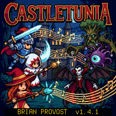
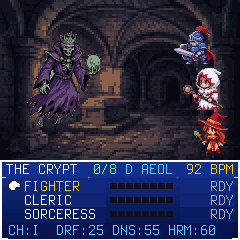
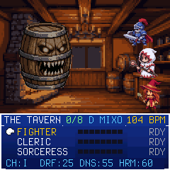
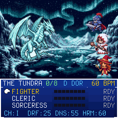
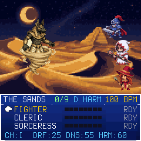
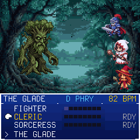
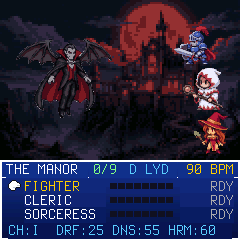
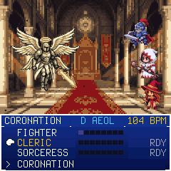
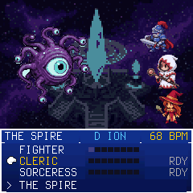
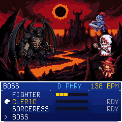

# Castletunia

**A standalone generative dungeon-synth & 16-bit RPG battle soundtrack firmware for the M-VAVE FM-1 pocket synthesizer.**

[](LICENSING.md)

Turn your **M-VAVE FM-1** into a living 16-bit RPG boss battle where every musical phrase you play on the 27-key keyboard becomes an attack by your three-member Party—**Fighter**, **Cleric**, and **Sorceress**—while the Stage Boss charges up counter-attacks that reshape the music and battlefield.

- **Multi-Engine Pure Fixed-Point Synthesis (6 Pad Modes + 5 Party Voice Engines):** Play `1–16` note phrases on the monotonic 27-key scale keyboard. Every stage pairs a dedicated backing chord pad (**Pipe Organ**, **Bowed Strings**, **Glassy Crystal**, **Woody Medieval Drone**, **Royal Brass**, **Dark Supersaw**) with distinct Fighter, Cleric, and Sorceress instruments synthesized across 5 engines (**2-Op FM**, **Plucked String**, **Breathy Woodwind/Reed**, **Detuned Analog Saw**, and **Additive Organ/Choir**) — all pure 32-bit Q15 integer DSP with zero WAV samples.
- **9 Contrasting Fantasy Stages & Auto-Advancing Battles:** Boots onto a random realm (or turn `SELECT` anytime) across 9 distinct pixel-art dioramas, scales, chord progressions, drum kits, and per-zone character timbres—from **The Crypt** and **The Tundra** to **The Palace** and **The Chasm**. While unlocked, **Intensity** climbs automatically from **`20%` → `100%`** across `8–10` turns (growing the drums, backing pad swell, and Fighter climax octaves) before an **FF6-style scanline Boss Defeat**, a **1-bar key-matched Victory Fanfare**, and beat-synced progression into the next realm (looping `9 → 1`, resetting Intensity to `20%`).
- **Boss Counter-Attacks with 3-Beat Buildup:** Each Boss has its own turn cooldown (`3`, `4`, or `5` player turns). When ready, a **3-beat accelerating drum-roll buildup** (`> BOSS CHARGING!`) culminates on the beat in a tension chord sting, lunge animation, zone-tinted sine-wave ripple, and a unique **1-bar musical curse**.
- **Tactile Spells, Stage Lock & Stage Weather:** Cast **Haste (`1.5×`)**, **Mirror** (flips Party & Boss + reverses step order), **Character Special Attacks** (`OMNISLASH`, `PURIFY`, `METEOR`), **Stage Environment / Weather** (`SEQ`, 2 measures), **Provoke Boss** (`GLO` tap), and **Stage Lock** (`SAVE` toggles auto-advance ON/OFF with a header padlock icon), plus 7 one-knob-per-function encoders (`Intensity`, `Drift`, `Density`, `Harmony`, `Weave`, `BPM`).
- **`240×240` 256-Color Boot Splash & Live Battle HUD:** Boots into a skippable 3-second pixel-art splash screen, then displays the live animated battle scene, per-character activity meters, status badges (`SLW` / `PSN` / `BSK` / `FRZ` / `HST` / `RDY`), and beat-synced battle ticker.

| Boot Splash | 1 · The Crypt | 2 · The Tavern | 3 · The Tundra | 4 · The Sands |
|---|---|---|---|---|
|  |  |  |  |  |

| 5 · The Glade | 6 · The Manor | 7 · The Palace | 8 · The Spire | 9 · The Chasm |
|---|---|---|---|---|
|  |  |  |  |  |

---

## Quick Start & Flashing

> **Compatibility, Backup & Disclaimer:** Built and tested on the **M-VAVE FM-1** (original hardware). Before flashing custom firmware, back up any stock FM-1 patterns/presets you want to keep using M-Vave's desktop/web tool. **Use at your own risk**—this firmware is provided as-is with no warranty, and the author is not responsible if flashing or using it damages or bricks your device. You can restore stock firmware using the steps in [Recovery](#recovery--restoring-stock-firmware).

1. Plug the FM-1 into your computer with a USB-C data cable and power it on.
2. Install Python dependencies (`pip install mido python-rtmidi`), build or download `build/dinghy.fwsc`, and flash:
   ```sh
   ./build.sh
   python3 tools/fm1_install.py build/dinghy.fwsc
   ```
3. On boot, the **Castletunia** splash displays for **3 seconds** (or press any key/button to skip).
4. Play a phrase on the 27 silicone keys for **Fighter**, wait ~0.85 s for the notes to fly at the Boss, and the backing chords & drums kick in automatically!

---

## Panel Layout

```text
+-------------------------------------------------------------------+
| [MASTER]  [SELECT]   +---------------+   [KNOB1] [KNOB2] [KNOB3] [KNOB4]
|                      |  240x240 LCD  |                            |
| [PRESETS] [ALGORITHM]|  Battle Stage |   [FX]  [SEL] [ENV] [LFO] [EDIT] [GLO]
|                      |  & Party HUD  |   [HOME][SAVE][ARP] [SEQ] [PLAY] [REC]
|      [OCT-] [OCT+]   +---------------+                            |
|                                                                   |
|  [0] [1] [2] [3] [4] ... (27 Monotonic Scale-Quantized Keys) [26] |
+-------------------------------------------------------------------+
```

---

## Controls Cheat Sheet

### Encoders (Top Row)

| Knob | Primary Layer | Hold **`GLO`** Shift Layer |
|---|---|---|
| **`MASTER`** | Hardware master output volume | Hardware master output volume |
| **`SELECT`** | Switch Stage / Zone (`0`–`8`) | Shift Root Key (`C`–`B`) |
| **`PRESETS`** | **Tempo** (`55–160 BPM`) | Backing Chord / Drone Volume |
| **`ALGORITHM`** | **Intensity** (`0%–100%`: percussion activity & FM grit) | Reverb Override |
| **`KNOB1`** | **Drift** (`0%–100%`: stepwise motif evolution per loop) | Fighter Volume |
| **`KNOB2`** | **Density** (`0%–100%`: sparse thinning vs. passing-tone bloom) | Cleric Volume |
| **`KNOB3`** | **Harmony** (`0%–100%`: chord progression richness & 3rd/5th pad) | Sorceress Volume |
| **`KNOB4`** | **Weave** (`0%–100%`: harmonic/contrapuntal interaction `>=35%`, polyrhythm `>65%`) | Percussion Volume |

### Buttons

| Button | What It Does |
|---|---|
| **`LFO`** | **Spell — Haste:** Toggles **`1.5×`** tempo for Cleric & Sorceress (`HST` badge; LED blinks). |
| **`EDIT`** | **Spell — Mirror:** Flips Party to the left facing right & Boss to the right facing left, and reverses step order. |
| **`ARP`** | **Special Attack (Ends Turn):** Fighter = **`OMNISLASH`** (power-octave flurry + shake); Cleric = **`PURIFY`** (chimes + halo ring + **cures all Party status effects**); Sorceress = **`METEOR`** (descending cascade + `22×22` fireball). Advances turn & Boss cooldown. |
| **`SEQ`** | **Stage Environment / Weather (2 Measures):** Triggers a 25% stage-wide tint, 18 full-screen weather particles, and stage-specific musical FX (**Grave Mist**, **Ale Bubbles**, **Snowfall**, **Sandstorm**, **Fireflies**, **Crimson Rain**, **Confetti**, **Starfall**, **Embers**). Automatically clears after **2 full measures** (or press `SEQ` again / change stage to clear early). |
| **`GLO` (Tap)** | **Provoke Boss:** Rings the Stage Boss bell and immediately launches the Boss's **3-beat drum-roll buildup & Counter-Attack** (`> BOSS PROVOKED!`). |
| **`FX` / `SEL` / `ENV`** | **Cycle RPG Status** on Fighter / Cleric / Sorceress: `Clear` → **`SLW`** (turns into a **Sloth**, 2× length across 2 bars + chord-fit) → **`PSN`** (`vii` tension & decay) → **`BSK`** (octave/5th slashes, `125%` vel) → **`FRZ`** (mute & turn-skip). Flashes for **1 s** before audio kicks in so you can skip past states cleanly. |
| **`HOME`** | Skip to the next unfrozen Party member without starting playback. |
| **`REC` (Tap / Hold)** | **Tap:** Cancel recording or clear current character (`RDY`). **Hold 600 ms:** Clear all unfrozen characters. |
| **`PLAY/STOP`** | Pause / Resume all audio (chords, drums, and loops). While paused, playing a phrase automatically resumes on commit. |
| **`SAVE`** | **Stage Lock (`ON/OFF`):** Locks the current realm to prevent auto-advancing on Boss Defeat (`SAVE` LED lights solid + gold padlock icon in header). |
| **`OCT-` / `OCT+`** | Shift Root Key down or up (`C`–`B`). |

---

## "How Do I…" Quick Recipes

- **Start a jam from silence:** Power on (the unit boots quiet onto a random stage with root keys glowing). Play any 1–16 note phrase on the keys and release—after ~0.85 s of silence, your character attacks with flying eighth-notes and the backing band kicks in on beat 1.
- **Enter phrases smoothly while the band is playing:** Play notes for the active character; once you pause for ~0.75 s, the commit waits for the **next quarter-note beat** so your transition locks cleanly to the groove.
- **Solo live over the band:** Freeze all three characters (`FX`, `SEL`, `ENV`) to enter **Live Jam Bypass**—the 27 keys play Sorceress live without overwriting any slots.
- **Make rhythms polyrhythmic:** Turn **`KNOB4` (`Weave`)** past `65%` so Fighter (`7` steps), Cleric (`11` steps), and Sorceress (`13` steps) phase across each other.

---

## The 9 Stages & Boss Counter-Attacks

When all 3 Party members are active, each Boss counts player turns according to its **Cooldown**, then launches a **3-beat accelerating drum-roll buildup** (`> BOSS CHARGING!`) into a beat-timed **chord sting** and **1-bar musical curse**:

| # | Stage | Scale & BPM | Boss | Cooldown | 1-Bar Curse & Visual FX |
|---|---|---|---|---|---|
| **1** | **`THE CRYPT`** | Aeolian · `92 BPM` | **Lich** | 4 turns (`8` clear) | `> LICH: DOOM!` · Purple ripple, cathedral reverb surge, sub-octave drop (`-7`), `bII` chord |
| **2** | **`THE TAVERN`** | Mixolydian · `104 BPM` | **Mimic** | 4 turns (`8` clear) | `> MIMIC: BRAWL!` · Amber ripple, wild swing (`58%`), battle drum fills (`95%`), FM grit |
| **3** | **`THE TUNDRA`** | Aeolian · `60 BPM` | **Wyrm** | 4 turns (`8` clear) | `> WYRM: BLIZZARD!` · Ice ripple, cathedral reverb surge, `+1` octave shimmer (`+7`) |
| **4** | **`THE SANDS`** | Phrygian Dom. · `100 BPM` | **Anubis** | 3 turns (`9` clear) | `> ANUBIS: SANDSTORM!` · Gold ripple, `bII` Phrygian tension chord, battle drum fills (`95%`) |
| **5** | **`THE GLADE`** | Dorian · `82 BPM` | **Treant** | 5 turns (`10` clear) | `> TREANT: OVERGROW!` · Emerald ripple, `100%` density + lush arpeggio cascades (`{2, 4, 7}`) |
| **6** | **`THE MANOR`** | Harmonic Min. · `90 BPM` | **Vampire** | 3 turns (`9` clear) | `> VAMPIRE: BLOOD MOON!` · Crimson ripple, temporary `Mirror` inversion, FM grit |
| **7** | **`THE PALACE`** | Ionian · `104 BPM` | **Seraph** | 4 turns (`8` clear) | `> SERAPH: JUDGMENT!` · Gold ripple, `IV → V` fanfare cadence, `100%` density, snare fills |
| **8** | **`THE SPIRE`** | Lydian · `68 BPM` | **Beholder** | 4 turns (`8` clear) | `> BEHOLDER: WARP!` · Cyan ripple, `1.5×` Haste, reverb surge, `+1` octave shimmer (`+7`) |
| **9** | **`THE CHASM`** | Locrian · `138 BPM` | **Demon** | 5 turns (`10` clear) | `> DEMON: METEOR!` · Magenta ripple, `bII` chord, `1.5×` Haste, `100%` density, battle drums, FM grit |

---

## Building from Source & Tests

Requires Docker (macOS/Windows) or Linux x86-64 with the JieLi `pi32v2` toolchain (`./tools/get_toolchain.sh`), plus Python 3 (`Pillow`, `mido`, `python-rtmidi`).

```sh
# Regenerate pixel-art headers & previews (120x80 zones, 42x42 party, 96x96 bosses, 240x240 splash)
python3 tools/gen_assets.py

# Host TDD Suite (4 stages, no hardware required)
gcc -DSTANDALONE_TEST -O2 -Wall -Wextra -Ifirmware/src firmware/src/castletunia_zones.c firmware/src/castletunia_engine.c tests/test_castletunia.c -DTEST_STAGE=1 -o build/test_s1 && ./build/test_s1
gcc -DSTANDALONE_TEST -O2 -Wall -Wextra -Ifirmware/src firmware/src/castletunia_zones.c firmware/src/castletunia_engine.c firmware/src/castletunia_dsp.c tests/test_castletunia.c -DTEST_STAGE=2 -o build/test_s2 -lm && ./build/test_s2
gcc -DSTANDALONE_TEST -O2 -Wall -Wextra -Ifirmware/src firmware/src/castletunia_zones.c firmware/src/castletunia_engine.c firmware/src/castletunia_ui.c tests/test_castletunia.c -DTEST_STAGE=3 -o build/test_s3 && ./build/test_s3
gcc -DSTANDALONE_TEST -O2 -Wall -Wextra -Ifirmware/src firmware/src/castletunia_zones.c firmware/src/castletunia_engine.c firmware/src/castletunia_dsp.c firmware/src/castletunia_input.c firmware/src/castletunia_ui.c tests/test_castletunia.c -DTEST_STAGE=4 -o build/test_s4 && ./build/test_s4

# Dinghy Host Emulator (renders WAV + PNG screenshots)
sh tests/run_host.sh tests/scripts/castletunia.txt

# Hardware Firmware Package (outputs build/dinghy.fwsc)
./build.sh
```

<details>
<summary>Code Layout</summary>

| File | Role |
|---|---|
| `firmware/src/dinghy.c` | App entry, 3 s skippable boot splash, random start stage, `app_audio` ISR, superloop |
| `firmware/src/castletunia_engine.c` | Capture state machine, beat-locked transitions, 4-bar `A/B/A/C` arranger, auto-advance & Victory Fanfare, Boss buildup & cooldowns, Spells |
| `firmware/src/castletunia_dsp.c` | Pure 32-bit fixed-point Q15 multi-engine synth (6 pad modes, 5 Party voice engines), FM percussion, Schroeder reverb, soft-clipper |
| `firmware/src/castletunia_zones.c` | 9 Stage definitions (scales, chord progressions, BPMs, reverb, per-zone Party & percussion patches) |
| `firmware/src/castletunia_input.c` | 27-key scanner, 7 macro encoders + `GLO` shift layer, 14 function buttons, key/button LEDs |
| `firmware/src/castletunia_ui.c` | `240×240` 256-color boot splash, differential diorama/sprite renderer, flying note projectiles, HUD & ticker |
| `firmware/src/castletunia_assets.h` | Packed 4-bit & 8-bit RGB565 pixel-art assets generated by `tools/gen_assets.py` |
| `tests/test_castletunia.c` | Standalone 4-stage C unit & integration test suite |

</details>

---

## Recovery & Restoring Stock Firmware

- **USB Rescue Mode:** Hold **`OCT-`** while turning on the power switch to boot into the USB updater.
- **Reflash Castletunia:** `python3 tools/fm1_install.py build/dinghy.fwsc`
- **Restore Stock Firmware:** Use M-Vave's updater with your factory firmware package, or flash a backup package with `tools/fm1_install.py`.

---

## License & Credits

Distributed under the **GNU General Public License v3.0 (GPL-3.0)**. See [LICENSE](LICENSE) and [LICENSING.md](LICENSING.md) for full per-file attribution and third-party licenses.

Built on [Dinghy](https://github.com/zvenson/dinghy) by **zvenson**, which stands on the work of **Leo Kuroshita (@kurogedelic, Hügelton Instruments)** ([Felucca](https://github.com/hugelton/Felucca)), **isod89** ([SLOOP](https://github.com/isod89/sloop-fm1)), **M. Geisler (genkigenki / makkuro)** ([genkigenki/sloop-fm1](https://github.com/genkigenki/sloop-fm1)), **illuminus5** ([Skiff](https://github.com/illuminus5/skiff)), and **ChanceTheMaker / keremimo** (Felucca Salt).
